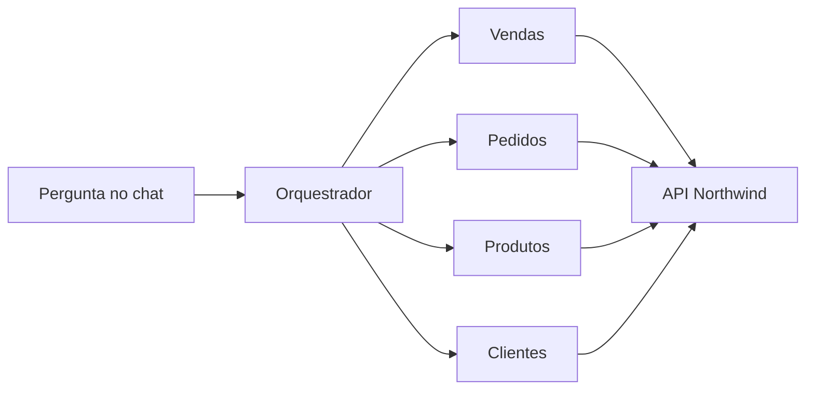
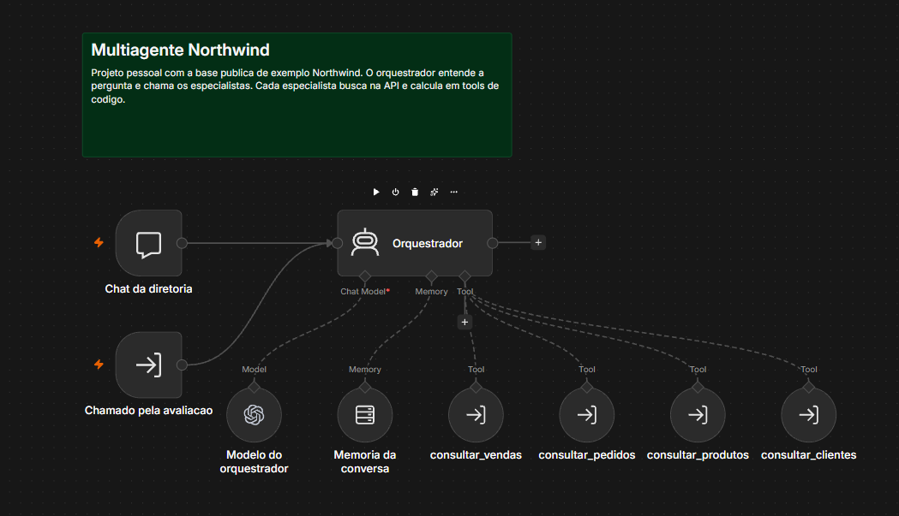
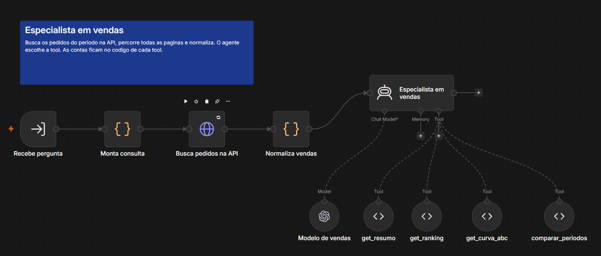
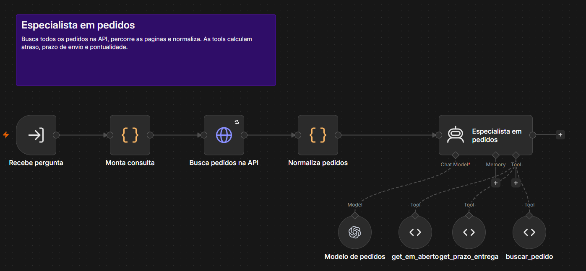
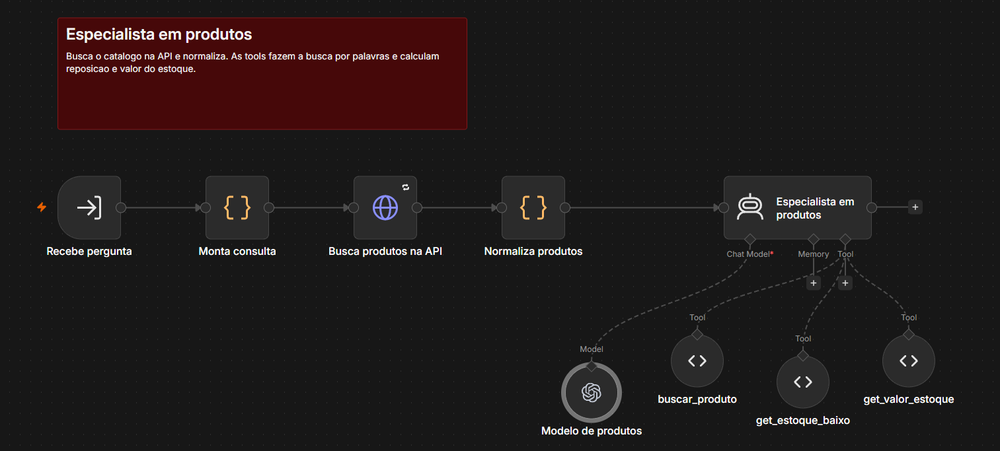
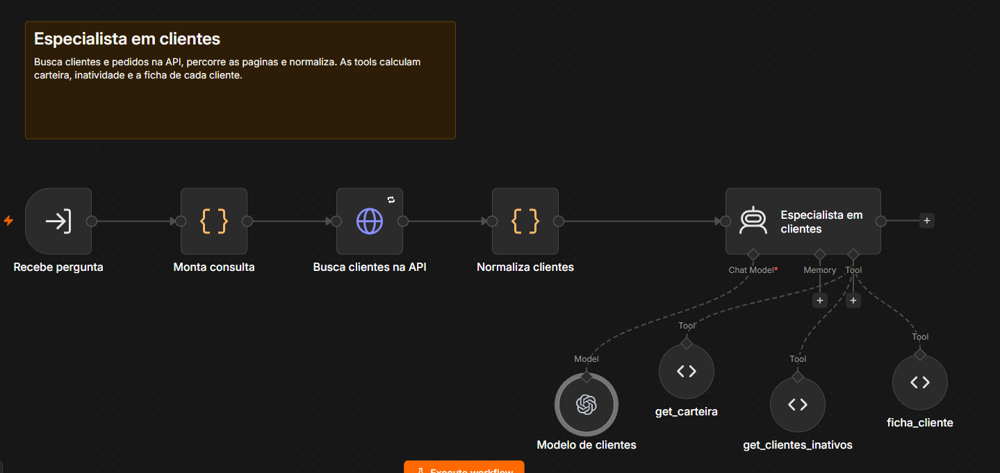

# Assistente de gestão multiagente em n8n

Chat em português que responde perguntas de gestão com dados da Northwind, uma base pública de exemplo. Um orquestrador entende a pergunta e chama quatro agentes especialistas: vendas, pedidos, produtos e clientes.

**Tipo de projeto:** pessoal, desenvolvido com apoio de IA. Não é um sistema em produção.

**Teste:** [abra o chat no portfólio](https://lilianmarqs.github.io/#projetos).

## O que ele responde

- "Quanto vendemos em abril de 1998?"
- "Monte a curva ABC de 1997."
- "Tem pedido atrasado? Quantos vencem nos próximos 7 dias?"
- "Quanto vale o estoque?"
- "Quanto vendemos em abril de 1998, quantos pedidos estão em aberto e quantos itens estão abaixo do mínimo?"

## Como funciona

1. O orquestrador identifica o assunto e o período da pergunta.
2. Cada especialista busca os dados na API e percorre todas as páginas.
3. Os dados são normalizados antes de chegar ao agente.
4. As contas ficam em 13 tools de código. O modelo escolhe a tool, mas não calcula o resultado.
5. O orquestrador monta a resposta final com os números recebidos.

## Decisões do projeto

- **Contas em código:** totais, rankings, curva ABC, comparação de períodos e prazos saem de JavaScript.
- **Período obrigatório:** se a pergunta precisa de período e ele não foi dito, o assistente pergunta antes de consultar.
- **Sem dados é diferente de falha:** as tools devolvem status próprios para cada situação.
- **Somente leitura:** o assistente não altera dados e recusa assuntos fora da Northwind.
- **Limites na demonstração:** 60 mensagens por dia, 15 por conversa e 400 caracteres por mensagem.

## Avaliação

O fluxo [`06-avaliacao-automatica.json`](workflows/06-avaliacao-automatica.json) envia 30 perguntas ao orquestrador. Elas cobrem vendas, pedidos, estoque, clientes, continuidade da conversa, limites do assistente e casos sem dados. A lista está em [`avaliacao/perguntas.md`](avaliacao/perguntas.md).

Nas cinco rodadas feitas com gabarito independente em pandas, os acertos foram 29, 28, 29, 29 e 30 de 30. Só uma rodada ficou sem erro, então o resultado não significa que o assistente sempre acerta.

## Fluxos

| Orquestrador | Vendas |
| --- | --- |
|  |  |

| Pedidos | Produtos | Clientes |
| --- | --- | --- |
|  |  |  |

## Como rodar

1. Importe no n8n os arquivos da pasta [`workflows`](workflows).
2. Crie uma credencial da OpenAI e selecione-a nos nós de modelo. Os fluxos usam `gpt-6-luna`, mas outro modelo compatível pode ser escolhido.
3. Nas tools do orquestrador, selecione os quatro fluxos especialistas no lugar de `CONFIGURE_ESPECIALISTA_...`.
4. Na avaliação, selecione o orquestrador no nó `Chama orquestrador`.
5. No nó `Chat da diretoria`, troque `https://SEU-SITE` pelo endereço do seu site.
6. Publique os fluxos e teste pelo chat.

## Tecnologias

n8n, OpenAI, JavaScript, API OData da Northwind e pandas na conferência do gabarito.

---

## English summary

Personal project built with AI assistance. A Portuguese chat uses an n8n orchestrator and four specialist agents to answer management questions from the public Northwind sample API. Calculations run in 13 JavaScript tools. A 30-question evaluation scored 29, 28, 29, 29 and 30 across five runs.
